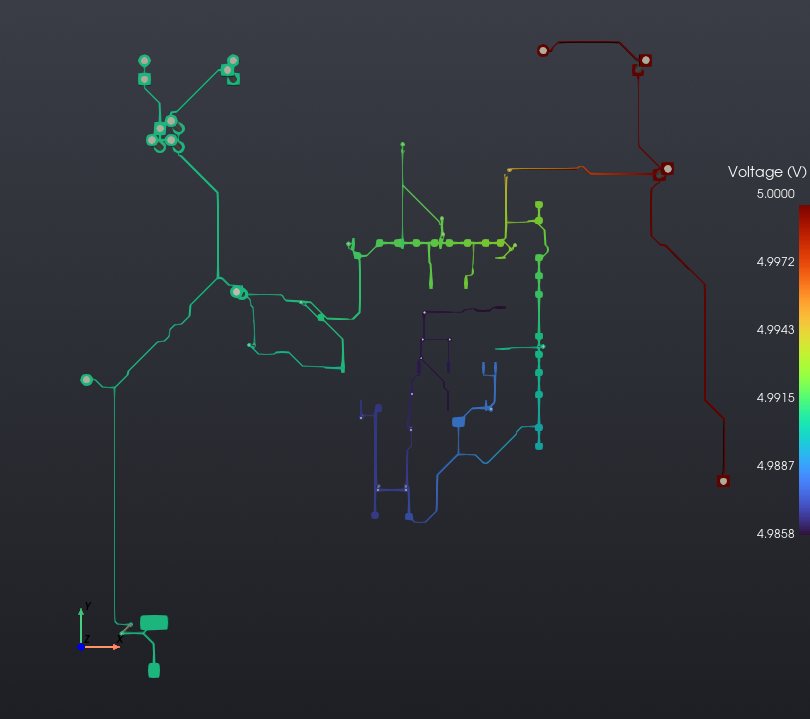
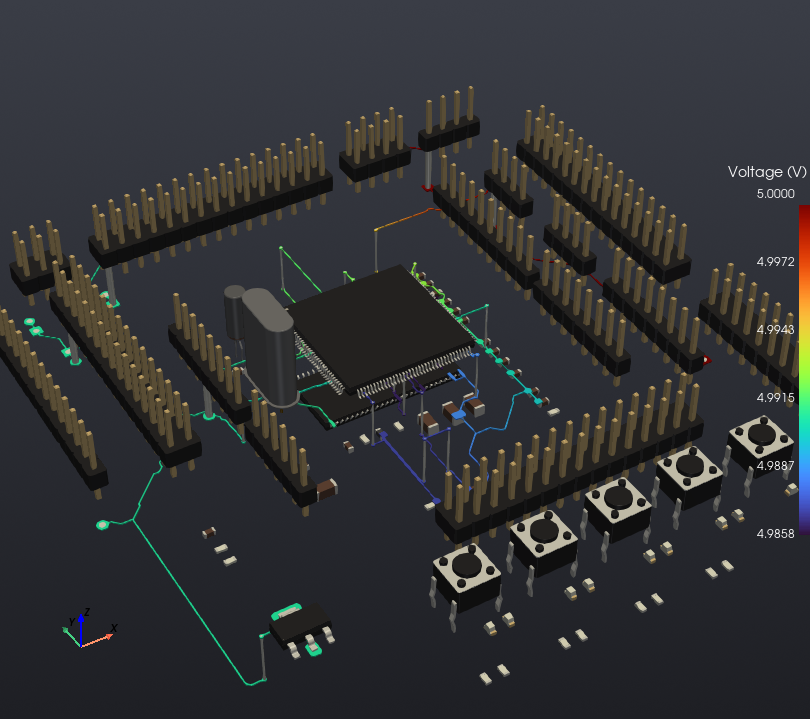
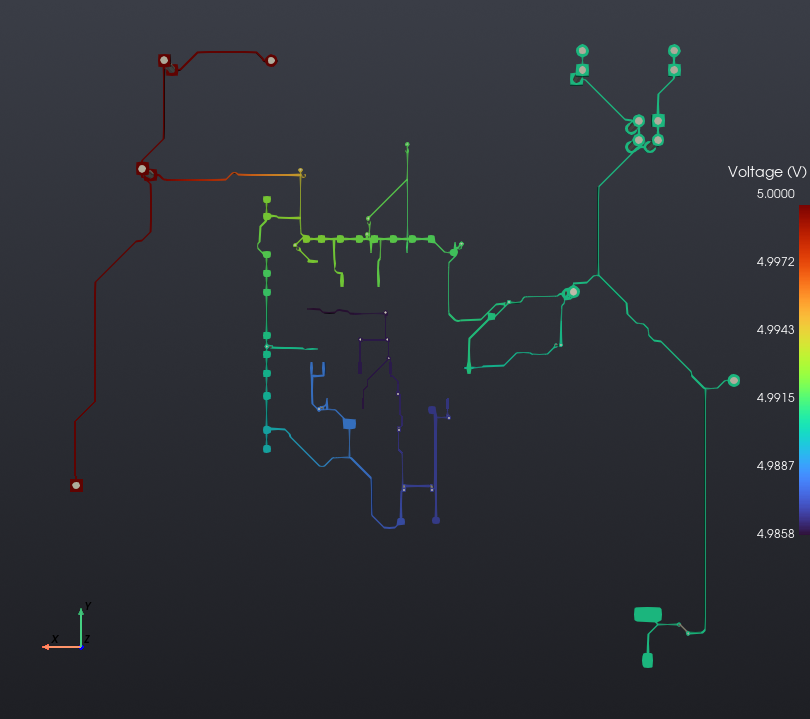

# ARM Processor PCB Design (KiCad)

PCB design for an ARM-based board ("ArmVaquita"), from schematic capture through component placement and trace routing, built in KiCad.

## What's in this repo

- `ArmVaquita.kicad_pro` / `.kicad_pcb` — earlier board revision
- `Placa routeada/` — final routed version (`PLACAROUTEADA.kicad_pcb`), fully routed with copper pours and vias
- `Plot/` — exported Gerber/drill files, ready for fabrication

## Board features

- ARM Cortex-M MCU in QFP package as the central component
- USB connector for power/programming
- 4 user pushbuttons + reset button
- 8 status LEDs
- Multiple expansion headers (BOOT, camera interface, general I/O)
- Full 2-layer routing with ground pour

The 3D render above was generated directly from the routed board file with `kicad-cli pcb render`.

## Power Integrity Analysis (DC)

Revisited this board after it was built, to check with proper tooling whether any power-distribution
issue could explain the things that didn't work right on the physical unit. DC voltage-drop analysis
of the +5V rail, run with [KiPI](https://github.com/drewsum/KiPI) on `ArmVaquita.kicad_pcb` (the
earlier board revision, not the final routed one).

<table>
<tr>
<td></td>
<td></td>
<td></td>
</tr>
</table>

**Result:** the +5V net drops from 5.0000V at the source down to **4.9858V** at its farthest point —
about **14mV** of IR drop across the distribution traces. Not large enough on its own to explain a
board-level failure, but a real, measured number rather than an assumption.

An AC impedance-vs-frequency sweep (the more relevant check for whether the decoupling network, not
just the copper, holds up under fast switching transients) was attempted but not completed — KiPI's AC
mode setup didn't come together this session.
